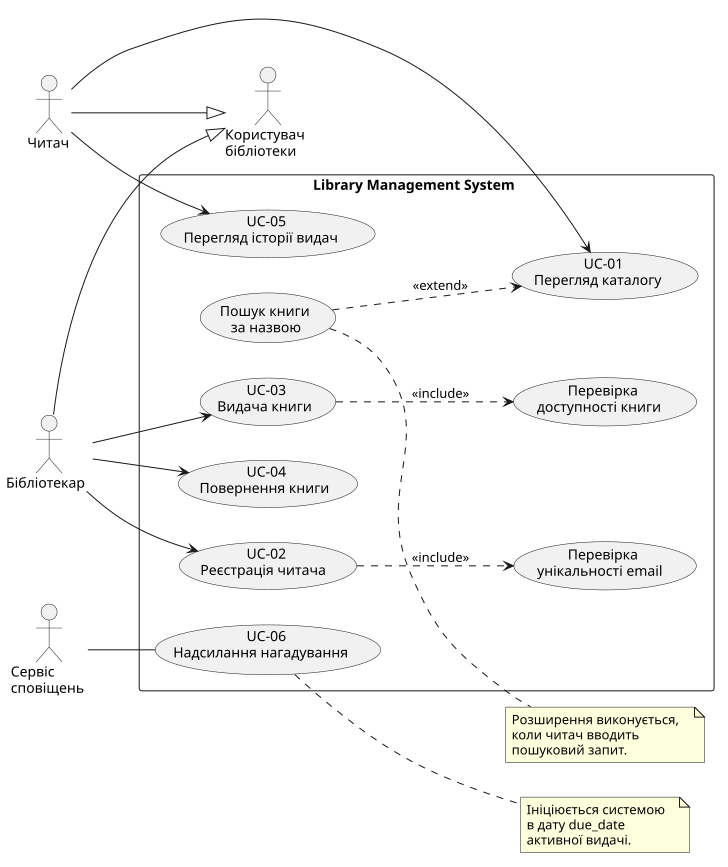

# Use Case Diagram — Library Management System

## 1. Опис

На діаграмі показані основні можливості бібліотечної системи та користувачі, які можуть ними користуватися.

Я залишив тільки ті прецеденти, які відповідають діям читача або бібліотекаря. Внутрішні перевірки системи описані окремо у вимогах EARS.

## 2. Діаграма

Вихідний код діаграми знаходиться у файлі `use-cases.puml`.

## 3. Актори

У системі є два актори.

**Читач** — переглядає каталог, шукає книги та переглядає власну історію видач.

**Бібліотекар** — реєструє читачів, видає книги та оформлює повернення.

Загального актора «Користувач бібліотеки» прибрано, тому що він не мав власних прецедентів.

## 4. Основні Use Cases

| ID | Прецедент | Актор |
|---|---|---|
| UC-01 | Перегляд каталогу та пошук книг | Читач |
| UC-02 | Реєстрація читача | Бібліотекар |
| UC-03 | Видача книги | Бібліотекар |
| UC-04 | Повернення книги | Бібліотекар |
| UC-05 | Перегляд власної історії видач | Читач |

## 5. Детальний прецедент UC-03

Для детального опису я вибрав видачу книги, тому що під час цієї операції потрібно перевірити декілька умов.

Перед видачею бібліотекар повинен увійти в систему, вибрати зареєстрованого читача та доступну книгу.

Також потрібно вказати дату повернення, яка не може бути раніше дати видачі.

Для UC-03 створено чотири сценарії:

- SC-01 — успішна видача книги.
- SC-02 — книга вже видана.
- SC-03 — неправильна дата повернення.
- SC-04 — читач не зареєстрований.

Вони описані у файлі `scenarios.md` та пов'язані з EARS-вимогами REQ-05, REQ-06, REQ-11, REQ-12 і REQ-13.

## 6. Чому внутрішніх перевірок немає на діаграмі

Перевірка доступності книги та перевірка унікальності email не є самостійними цілями користувачів.

Тому я прибрав їх із Use Case Diagram.

Перевірка доступності книги описана в REQ-06, а перевірка унікальності email — у REQ-04.

Автентифікація описана як наскрізна вимога REQ-13.

## 7. Поза обсягом

У цій ітерації не розглядаються:

- автоматичні нагадування;
- бронювання книг;
- штрафи за прострочення;
- оплата послуг бібліотеки.

Ці можливості можна додати в наступних версіях системи.

## 8. Висновок

У новій версії діаграми залишилися два актори та п'ять основних Use Cases.

Найдетальніше розглянуто UC-03 «Видача книги», для якого підготовлено чотири сценарії.

Тепер діаграма показує основні цілі користувачів, а внутрішні перевірки залишаються у функціональних вимогах.
